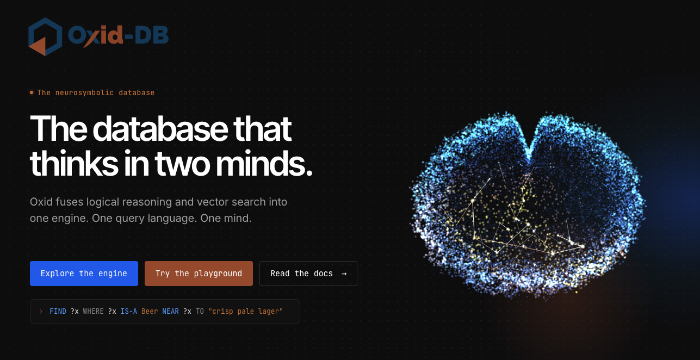

<h1 align="center">
  
   
</h1>

  <b>The database that thinks in two minds</b> 
  Logical reasoning and vector search in one engine. One query language. One mind.

<h3 align="center">
  <a href="https://www.oxid-db.com">Website</a> &bull;
  <a href="https://docs.oxid-db.com">Docs</a> &bull;
  <a href="https://learn.oxid-db.com">Learn</a> &bull;
  <a href="https://www.oxid-db.com/playground">Playground</a> &bull;
  <a href="https://www.oxid-db.com/blog">Blog</a>
</h3>

---

Most stacks bolt a vector database onto a knowledge graph and glue the two together in application code. Two stores means two truths: embeddings drift from the graph, identity gets duplicated, and every query ends in fragile post-filtering.

[Oxid-DB](https://www.oxid-db.com) keeps the ontology, the facts and the embeddings under one set of identifiers. A single [OxQL](https://learn.oxid-db.com) query narrows by logic and ranks by vectors in one pass — and can explain why a result came back. Built in Rust, it ships as a single binary with ACID storage, MVCC snapshot isolation and `AS OF` time travel.

## Getting Started

Read the [documentation](https://docs.oxid-db.com) to learn how Oxid-DB works, or run a query against a live instance in the [playground](https://www.oxid-db.com/playground) — 50,000 entities, reasoner and vector index in one query, no signup. When you're ready, [apply for early access](https://www.oxid-db.com/get-started).

## The Ecosystem

Three products, one cognitive loop — perception, cognition and expression.

- **[Oxid Sensory](https://www.oxid-db.com/sensory)** — perceives. Turns text, code, PDFs and the web into structured meaning.
- **[Oxid-DB](https://www.oxid-db.com/oxid-db)** — reasons. The neurosymbolic core that stores, connects and reasons over everything it knows.
- **[Oxid Surface](https://www.oxid-db.com/surface)** — speaks. Where agents query, prompt and act on the database.

## Built for Agents

Agents ask in language. Oxid compiles the question into OxQL, reasons over the graph, and hands back an answer it can defend. The MCP server gives any client — Claude Code, Cursor, your own — typed tools instead of a REST wrapper, with typed SDKs for Node.js and Python today.

## This Organization

Oxid-DB is in research preview. SDKs, connectors, benchmarks and demos are published here as they open up — watch the organization to follow along.

## Contact

For early access, partnerships, press or investor enquiries, [get in touch](https://www.oxid-db.com/contact).
